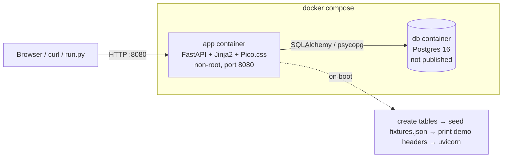

# Architecture

A deliberately boring stack: one Python web app, one Postgres database, server-rendered HTML. Everything runs
from `docker compose up` with the network off.



## Components

| Path | What it does |
|---|---|
| `src/app/main.py` | Builds the FastAPI app, registers the **app-wide** dependencies (`attach_auth`, `csrf_protect`), security headers, error handler (JSON for API clients, pages for browsers). |
| `src/app/auth.py` | Session cookie → user, `require_user` / `require_role`, CSRF, login throttle, safe redirects. |
| `src/app/security.py` | bcrypt passwords, SHA-256 token hashing, session creation. |
| `src/app/models.py` | All tables (see [DATA-MODEL.md](DATA-MODEL.md)). |
| `src/app/seed.py` | Idempotent import of `fixtures.json`, demo accounts, demo event, fixed demo sessions. |
| `src/app/boot.py` | Container entry point: create tables, seed, print headers, start uvicorn. |
| `src/app/routes/*` | Thin HTTP layer: parse form **or** JSON, call a service, render a page or return JSON. |
| `src/app/services/*` | All rules: deadlines, teams, submissions, judging isolation, assignment, normalization, exports, people. |
| `src/templates/`, `src/static/` | Jinja2 templates; Pico.css is vendored (no CDN). |
| `scripts/normalization_report.py` | Raw vs normalized ranking on the fixtures (see [JUDGING.md](JUDGING.md)). |
| `tests/` | 199 pytest tests, mostly over HTTP like curl. |

## Request flow

```
request
  → security_headers middleware
  → attach_auth       cookie "session" → sha256 → sessions row → user (role read fresh from DB)
  → csrf_protect      POST/PUT/PATCH/DELETE: JSON passes; forms need the session's CSRF token
  → route             Depends(require_user)            → 401 if anonymous
                      Depends(require_role(...))       → 403 if wrong role
  → service           object checks: is this YOUR team / YOUR score / assigned AND in your track?
                      deadline by DB clock, validation, DB constraints as the last net
  → audit(...)        sensitive writes append an audit_log row in the same transaction
  → response          HTML (Accept: text/html, non-/api path) or JSON with the real status code
```

## Where the auth and role checks live, and why

Three layers, each able to stop a request on its own:

1. **App-wide dependencies** (`main.py`): every route, including ones written later, gets identity and CSRF
   checks. Nothing to remember per route.
2. **Route dependencies** (`require_role`): the coarse "is this role allowed here at all". Participant on a judge
   route → 403 before any query runs.
3. **Service-level object checks**: the questions a role cannot answer. A judge is allowed on
   `/api/judge/scores`, but the query is always filtered to `current_user.id`, and asking for another id is 403.
   Scoring needs an assignment **and** track membership, checked independently, so one mistake is not enough.

Plus the database: unique constraints (one score per judge+project, one team per user per event, one active
project per team) and `CHECK`s (score 1–5) hold even if application code has a bug.

**Never in templates.** A hidden button is decoration; `tests/` hit the API directly the way curl and run.py do.

## Why this stack

- **FastAPI**: dependencies are the natural place for auth (`Depends(require_role(...))`), request validation,
  and a free OpenAPI page at `/docs`.
- **Server-rendered Jinja2 + Pico.css**: no JavaScript build, no CDN, works offline, and a strict CSP
  (`default-src 'self'`, no inline script) costs nothing because we have no inline script.
- **Postgres + SQLAlchemy 2**: real constraints, partial unique indexes, row locks (`FOR UPDATE` for team joins),
  and a single clock (`now()`) for deadlines. Tests run on in-memory SQLite through the same ORM for speed.
- **Our own auth**: required by the rules, and small: bcrypt + a sessions table + a CSRF token.

## Design decisions worth knowing

- **Deadline uses the database clock**, checked on create and edit, before membership checks.
- **One service function per rule**, called by both the HTML and JSON routes, so the two can't drift apart.
- **Drafts and foreign teams return 404, not 403**, so outsiders can't even confirm they exist.
- **Explicit ordering on every collection**: we hit a bug where tags came back in different orders inside and
  outside a session.
- **Assignment is a pure function** (`plan_assignments`) so the algorithm is unit-tested without a database.

## Configuration

| Env var | Default | Meaning |
|---|---|---|
| `DATABASE_URL` | SQLite file (`dev.db`) | Compose sets Postgres. |
| `FIXTURES_PATH` | `./fixtures.json` | What to seed. |
| `DEMO_SESSIONS` | `1` | Fixed, public demo session tokens. **Set `0` for real use**; boot deletes them. |
| `COOKIE_SECURE` | `0` | Set `1` behind TLS. |
| `BCRYPT_ROUNDS` | `12` | Tests use 4 for speed. |
