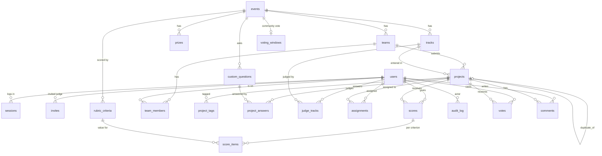

# Data model

21 tables, defined in [`src/app/models.py`](src/app/models.py). Primary keys are short strings: rows imported
from `fixtures.json` keep their fixture id (`evt_01`, `jdg_07`, `prj_41`), rows created in the app get a random
id with the same kind of prefix (`prj_3fa9c1e2b7d0`). All timestamps are stored and returned as UTC.

## Tables

### People
| Table | Key columns | Notes |
|---|---|---|
| `users` | id, email (unique, lower-case), name, password_hash, role | Role is one of participant / judge / organizer / admin. `password_hash` NULL = cannot log in yet (invited judge). |
| `sessions` | **token_hash** (PK), user_id, csrf_token, expires_at | Only SHA-256 of the cookie value is stored. |
| `invites` | **token_hash** (PK), user_id, created_by, expires_at, used_at | One-time judge invite links, hashed like sessions. |

### Events
| Table | Key columns | Notes |
|---|---|---|
| `events` | id, name, submissions_open, submissions_close, max_team_size, results_published_at | `CHECK max_team_size >= 1`. `results_published_at` NULL = hidden. |
| `tracks` | id, event_id, name | |
| `prizes` | id, event_id, track_id?, name, description | |
| `custom_questions` | id, event_id, prompt, required, position | Organizer-defined submission fields. |
| `rubric_criteria` | id, event_id, key, label, weight, position | Unique (event_id, key); `CHECK 0 <= weight <= 1`; sum = 1 enforced in the app. |

### Teams and projects
| Table | Key columns | Notes |
|---|---|---|
| `teams` | id, event_id, name, invite_token (unique) | |
| `team_members` | (team_id, user_id) PK, event_id | **Unique (event_id, user_id)**: one team per person per event. `event_id` is copied from the team so the DB can enforce this. |
| `projects` | id, event_id, team_id, track_id, title, tagline, description, 4 URLs, status, submitted_at, duplicate_of_id | **Partial unique index on team_id WHERE duplicate_of_id IS NULL**: one active project per team; flagged duplicates are exempt. |
| `project_tags` | (project_id, tag) PK | Lower-case. |
| `project_answers` | (project_id, question_id) PK, answer | |

### Judging
| Table | Key columns | Notes |
|---|---|---|
| `judge_tracks` | (judge_id, track_id) PK | Basis of track isolation. |
| `assignments` | (judge_id, project_id) PK, assigned_at | "Please review this." |
| `scores` | id, judge_id, project_id, comment | **Unique (judge_id, project_id)**. |
| `score_items` | (score_id, criterion_id) PK, value | **`CHECK value BETWEEN 1 AND 5`**. One row per rubric criterion, so the rubric is data, not columns. |
| `audit_log` | id, at, actor_id, action, entity_type, entity_id, detail (JSON) | Append-only from the app's side. |

### Community (T3)
| Table | Key columns | Notes |
|---|---|---|
| `voting_windows` | **event_id** (PK), opens_at, closes_at | `CHECK opens_at < closes_at`. A separate table rather than new columns on `events`, so existing databases pick it up without a migration. |
| `votes` | id, event_id, project_id, user_id, created_at | **Unique (user_id, project_id)**: one vote per person per project, enforced by the database even under concurrent requests. |
| `comments` | id, project_id, user_id, body, created_at, hidden_at | Moderation sets `hidden_at`; comments are never deleted (evidence). |

### Why scores are split into `scores` + `score_items`
The fixture has three fixed criteria, but the brief asks for an organizer-configurable rubric. One row per
criterion means changing the rubric never needs a schema migration, and the weighted total is computed from
the current weights (see [JUDGING.md](JUDGING.md)).

## How fixtures are imported

`src/app/seed.py`, run on every boot, **idempotent** (inserts a row only if its id is missing, never overwrites):

| Fixture | Becomes |
|---|---|
| `event` | `events` row with `submissions_close` **as given** (in the past → closed), default rubric 40/30/30 |
| `tracks` | `tracks` |
| `judges` | `users` (role judge, same id) + `judge_tracks` |
| `teams[].members` | `users` (role participant, id derived from the email hash) + `teams` + `team_members` |
| `projects` | `projects` (status submitted, `summary` → tagline + description). The **duplicate** is detected per team: the latest `submitted_at` wins (prj_41), earlier rows get `duplicate_of_id` (prj_07). |
| `scores` | `assignments` (a score implies an assignment) + `scores` + `score_items`; empty comments kept as "" |

Plus: an organizer (`organizer@dogfood.local`), an admin (`admin@dogfood.local`), an open demo event with three
tracks, a prize, a custom question and an open community-voting window, and four fixed demo sessions (only while `DEMO_SESSIONS=1`).

Result on a fresh database: 2 events, 11 tracks, 123 users, 40 teams, 91 memberships, 41 projects
(1 flagged duplicate), 126 scores, 378 score items. A restart adds nothing.

## Getting data in

- **Seed file:** replace `fixtures.json` (same shape) before first boot, or point `FIXTURES_PATH` at another file.
- **UI / JSON API:** organizers create events (`POST /api/events`), invite judges (`POST /api/judges/invite`),
  set rubrics and assignments; participants register, form teams and submit. Every route that accepts a form
  also accepts JSON. The OpenAPI page is at `/docs`.

## Getting data out

`GET /api/export.csv?kind=<kind>&event=<event_id>` (organizer/admin only, every export audited, spreadsheet
formula injection neutralised):

| kind | Columns |
|---|---|
| `projects` | event, project, title, tagline, team, team size, track, status, submitted_at, duplicate_of, URLs, tags |
| `scores` (default) | event, project, judge, one column per criterion, weighted_total, comment, updated_at |
| `progress` | event, judge, assigned, done, remaining, status |
| `results` | event, rank, track_rank, raw_rank, project, track, reviews, effective_reviews, raw_mean, z_mean, normalized, flags |
| `audit` | the whole audit log |

JSON equivalents: `/api/projects`, `/api/judge/scores`, `/api/events/{id}/progress`, `/api/events/{id}/results`,
`/api/events/{id}/votes` (staff any time, everyone after voting closes), `/api/projects/{id}/comments`, `/api/audit`.
